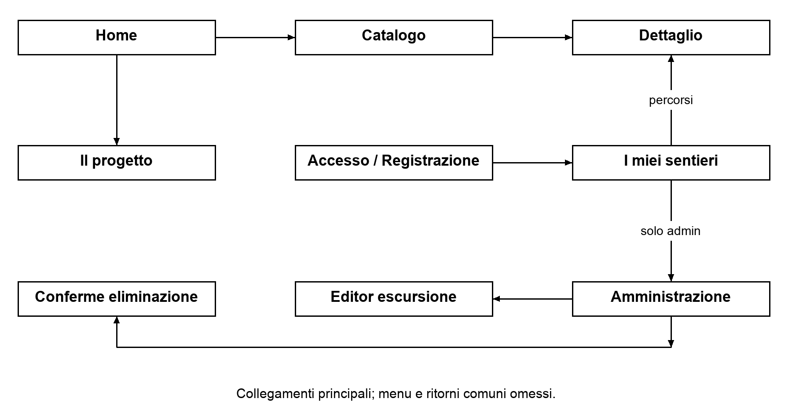
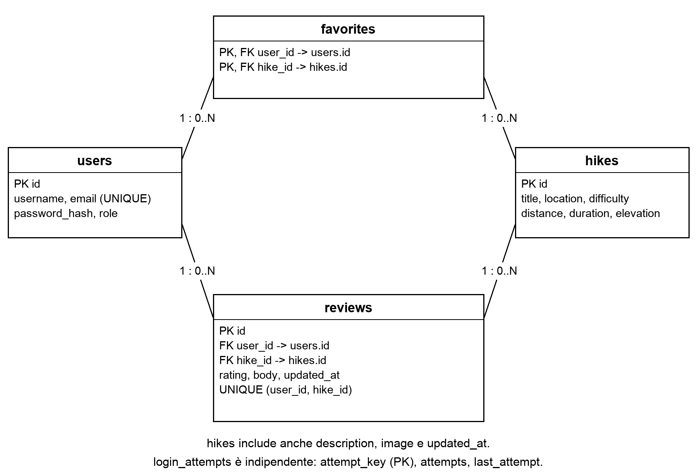

# Relazione Progetto di Tecnologie Web

**Passo Verde - Portale di escursioni e trekking**  
Università degli Studi di Padova - Corso di Laurea in Informatica  
Anno accademico 2026-2027  
Versione locale del 20 ottobre 2026

| Componente | Matricola |
| --- | --- |
| Persona uno | Da completare |
| Persona due | Da completare |
| Persona tre | Da completare |
| Persona quattro | Da completare |

**Indirizzo locale:** http://127.0.0.1:8085  
**Indirizzo sul server del corso:** da inserire dopo l'installazione.  
**Email del referente:** da completare.

| Ruolo | Nome utente | Password |
| --- | --- | --- |
| Utente | user | user |
| Amministratore | admin | admin |

Le credenziali riportate sono quelle degli account dimostrativi. L'indirizzo locale funziona soltanto sul computer che esegue il sito. Il sito non è ancora installato sul server universitario.

<!-- CORPO -->

# 1 Introduzione e analisi dei requisiti

## 1.1 Scopo del sito

Passo Verde è un portale dimostrativo per consultare escursioni e percorsi di trekking. Il catalogo permette di cercare un itinerario per nome o località e di selezionare una difficoltà. Ogni scheda presenta una fotografia, una descrizione e i dati principali del percorso. Gli utenti registrati possono conservare una lista di preferiti e pubblicare recensioni; l'amministratore aggiorna il catalogo e modera i contributi.

Il progetto usa percorsi, località e dati inventati. Le fotografie illustrano il tema del sito, ma non rappresentano necessariamente l'itinerario descritto. Il portale non contiene tracce GPS o informazioni verificate per organizzare escursioni reali. I dati servono a provare ricerca, filtri e gestione del catalogo.

## 1.2 Utenti e bisogni

Il pubblico di riferimento comprende persone che cercano una passeggiata semplice e persone interessate a itinerari più lunghi. L’analisi dell’utenza è basata sulle funzioni richieste; non sono state svolte interviste o raccolte statistiche.

Un visitatore deve poter confrontare rapidamente lunghezza, durata, dislivello e difficoltà. La consultazione è libera, mentre l'account è richiesto quando occorre conservare dati personali. Un utente abituale deve poter ritrovare i percorsi salvati e correggere o eliminare una propria recensione. L'amministratore deve poter mantenere aggiornati i contenuti senza intervenire sul codice.

Sono considerati anche accessi da schermi piccoli, uso della tastiera, ingrandimento del testo e lettori di schermo. Queste esigenze motivano etichette esplicite, contenuti testuali, controlli nativi e una struttura di pagina stabile.

## 1.3 Classi di utenza e funzionalità

| Classe | Operazioni disponibili |
| --- | --- |
| Visitatore | Consultare catalogo e dettagli; cercare per nome/località e difficoltà; leggere recensioni; registrarsi e accedere. |
| Utente autenticato | Funzioni pubbliche; aggiungere e rimuovere preferiti; consultare l'area personale; inserire, modificare ed eliminare la propria recensione; uscire dall'account. |
| Amministratore | Consultazione e funzioni di account; inserire, modificare ed eliminare escursioni; eliminare recensioni nell'area di moderazione. |

Per ogni coppia utente-escursione è ammesso un solo preferito e una sola recensione. L'utente può aggiornare la recensione esistente. L'area amministrativa è protetta sul server: nascondere il collegamento nel menu non è il controllo di autorizzazione.

## 1.4 Ricerche attese e reperibilità

Le ricerche ipotizzate riguardano il nome «Passo Verde», un nome di percorso, una località o espressioni come «escursioni facili» e «percorsi di trekking». Queste ricerche guidano la scelta di titoli, descrizioni ed etichette del catalogo.

Le pagine hanno un titolo che identifica il contenuto e termina con il nome del sito. Il dettaglio usa il titolo dell'escursione e una descrizione derivata dal suo testo. Le intestazioni organizzano le informazioni e i collegamenti permettono di raggiungere i dettagli dal catalogo. Non sono stati misurati posizionamento o indicizzazione: il prototipo è locale e i nomi dei luoghi sono inventati.

# 2 Progettazione

## 2.1 Organizzazione dei contenuti

La struttura è gerarchica e poco profonda. La home presenta il portale e consente di raggiungere il catalogo. Dal catalogo si passa alla scheda dell'escursione. La pagina «Il progetto» chiarisce la natura dimostrativa, spiega le difficoltà e riporta i crediti delle fotografie. «I miei sentieri» raccoglie i dati dell'utente autenticato. L'amministrazione è un ramo riservato.

La ricerca per nome/località e il filtro per difficoltà possono essere combinati. I parametri sono inviati con GET, così l'indirizzo descrive la ricerca e può essere riutilizzato. Il risultato riporta il numero di percorsi trovati; l'assenza di risultati è gestita con un messaggio e la possibilità di azzerare i filtri.

## 2.2 Mappa delle pagine

- Home: introduzione e accesso al catalogo.
- Escursioni: ricerca, filtro e risultati; da ogni risultato si apre il dettaglio.
- Dettaglio: dati del percorso, descrizione, preferito e recensioni.
- Il progetto: informazioni sul prototipo, difficoltà e crediti.
- Accesso e registrazione: ingresso e creazione dell'account.
- I miei sentieri: preferiti e recensioni personali.
- Amministrazione: elenco dei percorsi, editor, conferma di eliminazione e moderazione.

Le pagine di errore gestiscono contenuti inesistenti, accessi non autorizzati e problemi del servizio. La struttura comune mantiene disponibili i riferimenti per tornare alla navigazione.

La mappa distingue tre percorsi: consultazione pubblica (home, catalogo, dettaglio), gestione personale (accesso, area personale, dettaglio e recensioni) e manutenzione riservata (amministrazione, editor e conferme). La figura 1 rappresenta i collegamenti principali, senza ripetere i link comuni a tutte le pagine.

## 2.3 Struttura delle pagine e convenzioni

Intestazione, menu, percorso di navigazione e piè di pagina sono condivisi. Il logo rimanda alla home. Il menu usa etichette costanti e segnala la pagina corrente; il percorso di navigazione chiarisce la posizione nel sito. La parte centrale contiene un'intestazione principale e sezioni con titoli subordinati.

Nel catalogo ogni scheda usa lo stesso ordine per località, titolo, difficoltà e misure. La durata è mostrata in ore e minuti, la lunghezza in chilometri e il dislivello in metri. Le azioni usano verbi espliciti. I collegamenti ai dettagli includono nel nome accessibile il percorso a cui si riferiscono, evitando una sequenza di link indistinguibili.

Un esempio sui dati iniziali è la ricerca di «valle» con difficoltà «Facile»: il confronto riguarda titolo o località, quindi restituisce «Anello dei prati alti», ambientato nella Valle di Pratolungo. La scheda mostra 5,4 km, 2 h e 180 m di dislivello. Dopo l'accesso, il pulsante «Salva tra i preferiti» rende il percorso disponibile in «I miei sentieri»; la sua rimozione si esegue dalla scheda di dettaglio. Nell'area personale i collegamenti di modifica delle recensioni riportano al relativo modulo nella pagina dell'escursione. L'accesso porta all'area personale: non è previsto il ritorno automatico al dettaglio precedentemente consultato.

## 2.4 Modello dei dati

Il database contiene quattro tabelle del dominio e una tabella di supporto all'accesso. Le informazioni degli utenti sono separate da quelle dei percorsi. Preferiti e recensioni collegano le due entità senza duplicare nomi o descrizioni.

| Tabella | Dati e vincoli principali |
| --- | --- |
| users | Identificativo, username ed email univoci, hash della password e ruolo user/admin. |
| hikes | Identificativo, titolo, località, difficoltà, distanza, durata in minuti, dislivello, descrizione, immagine e data di aggiornamento. |
| favorites | user_id e hike_id; chiave primaria composta e chiavi esterne verso utenti e percorsi. |
| reviews | Identificativo, utente, percorso, voto 1-5, testo e data; vincolo univoco sulla coppia utente-percorso. |
| login_attempts | Chiave derivata dall'indirizzo di rete, numero di tentativi e istante dell'ultimo tentativo. |

Un utente e un percorso possono avere più collegamenti in favorites e reviews; ciascun collegamento appartiene a un solo utente e a un solo percorso. Le chiavi esterne con cancellazione a cascata rimuovono preferiti e recensioni quando viene eliminata l'entità collegata. Titolo, località e dati delle escursioni dipendono dalla chiave del percorso; le informazioni dell'account dipendono dalla chiave dell'utente. La media dei voti viene calcolata dalle recensioni e non memorizzata come dato duplicato.

La figura rappresenta lo schema relazionale implementato. Ogni utente e ogni escursione possono comparire in zero o più preferiti e recensioni; ogni riga di collegamento richiede esattamente un utente e un'escursione. login_attempts non ha una chiave esterna verso users, perché registra anche accessi con username inesistenti e usa una chiave derivata dall'indirizzo IP.

Nello schema MariaDB le chiavi identificative sono interi autoincrementali; username è VARCHAR(30), email VARCHAR(254) e password_hash VARCHAR(255). Titolo e località dei percorsi sono VARCHAR(100); distance è DECIMAL(5,1), mentre duration ed elevation sono interi. Le date di aggiornamento sono stringhe VARCHAR(19), nel formato anno-mese-giorno ore:minuti:secondi. Descrizione e recensione sono campi TEXT. Tutti gli attributi dichiarati sono NOT NULL. L'indice hikes_difficulty supporta il filtro della categoria; la ricerca testuale usa LIKE su titolo e località e non un indice full-text.

I vincoli SQL impediscono riferimenti inesistenti e duplicazioni dei collegamenti; i limiti applicativi più restrittivi, come la lunghezza massima del testo o i 100 km della distanza, vengono verificati in PHP. La separazione delle entità evita gruppi ripetuti di preferiti nelle righe degli utenti e duplicazioni del testo dei percorsi nelle recensioni. Non sono memorizzati contatori o medie da riallineare a ogni modifica.

# 3 Realizzazione dell'interfaccia

## 3.1 HTML e componenti comuni

Il sito genera HTML5 lato server, con lingua italiana e codifica UTF-8. Gli attributi sono quotati e i tag vuoti sono scritti con chiusura compatibile con le indicazioni locali sulla sintassi XML. Sono usati elementi semantici per intestazione, navigazione, contenuto principale, sezioni e piè di pagina.

I template comuni evitano differenze accidentali tra le pagine. Le tabelle sono riservate ai dati amministrativi; le schede del catalogo sono organizzate con liste e blocchi di contenuto. I moduli associano ogni controllo a un'etichetta e usano elementi HTML nativi per selezione, inserimento e invio.

## 3.2 CSS, colori e adattamento

La presentazione è separata dal markup e suddivisa in tre fogli: desktop.css, mobile.css e print.css. I primi due si applicano allo schermo; il foglio mobile interviene fino a 800 pixel. Il terzo si applica alla stampa. Non sono usati framework CSS o librerie di componenti.

La versione documentata contiene 412 righe nel foglio desktop, 64 in quello mobile e 85 in quello di stampa. Le regole usano bordi, spaziature, colori, Flexbox e griglie semplici. Il testo usa Arial e caratteri di sistema, evitando font da servizi esterni.

Il verde scuro richiama il tema naturale, mentre fondi chiari e bordi distinguono le aree. Le difficoltà sono espresse a parole e non soltanto dal colore. Collegamenti e pulsanti mantengono un'indicazione visibile del focus. Su schermi piccoli le colonne si riducono e il menu può essere raccolto in un pulsante. La tabella amministrativa conserva uno scorrimento interno senza allargare l'intera pagina.

Il contenuto principale ha larghezza massima di 1100 px. Il catalogo usa tre colonne su desktop, due fino a 800 px e una fino a 550 px. Le coppie immagine/testo, il dettaglio e i gruppi del modulo amministrativo passano da due colonne a una a 800 px. Flexbox dispone menu, filtri e gruppi di azioni e permette loro di andare a capo. I titoli usano rem; il corpo eredita la dimensione predefinita del browser. L’ordine dei contenuti rimane lo stesso anche quando le colonne si riducono.

| Elemento | Colore CSS | Impiego |
| --- | --- | --- |
| Verde | #244d3b | Collegamenti ordinari e pulsanti. |
| Fondo | #f6f4ed | Sfondo della pagina. |
| Fondo chiaro | #e7ecdf | Menu, ricerca e messaggi di conferma. |
| Testo | #263c31 | Testo principale. |
| Errore | #922e25 | Messaggi e azioni di eliminazione. |
| Focus | #9b5400 | Contorno della posizione di tastiera. |

I link testuali sono sottolineati e cambiano colore dopo la visita; la voce corrente del menu è in grassetto e ha un bordo inferiore. Nella home il primo blocco introduce subito tema e accesso al catalogo; nel dettaglio il riepilogo raccoglie le misure prima della descrizione estesa. Su schermi piccoli il contenuto prosegue su una colonna e richiede lo scorrimento verticale.

## 3.3 JavaScript

Il codice JavaScript è raccolto in un file esterno e gestisce tre compiti: apertura e chiusura del menu mobile, controlli aggiuntivi sulla password e focus sul riepilogo degli errori. Il menu aggiorna aria-expanded, si chiude con Escape e riporta il focus al pulsante. Il passaggio a una larghezza mobile evita di lasciare il focus in una voce diventata nascosta.

Nella registrazione viene controllata la coincidenza delle password e il limite di 72 byte tramite setCustomValidity. Questi controlli migliorano il riscontro immediato; il server li ripete. Le operazioni sui dati non dipendono da richieste asincrone: sono moduli PHP ordinari. Senza JavaScript il menu rimane disponibile e la validazione server resta attiva.

## 3.4 Immagini e stampa

Le fotografie sono conservate nella cartella pubblica, così la consultazione non richiede richieste ai servizi fotografici. Il logo è in SVG. Le immagini informative hanno un'alternativa testuale; il logo accanto al nome e i simboli decorativi non duplicano inutilmente il testo per il lettore di schermo.

Il foglio di stampa esclude menu, moduli e comandi non utili sul foglio, conserva le proporzioni delle immagini e limita le separazioni delle schede. Titoli e contenuto successivo sono mantenuti insieme quando possibile. I risultati delle anteprime sono descritti nella sezione sui test.

# 4 PHP, database e controllo degli input

## 4.1 Organizzazione del codice

La consegna comprende public per pagine, CSS, JavaScript e immagini; src per accesso ai dati e presentazione; database per schemi e dump; bin per preparazione ed esportazione. I modelli condivisi sono in src/html. README e relazione completano il pacchetto. Test, registri, sorgenti della relazione, Docker e database della demo restano in materiali-sviluppo. La cartella storage della consegna è vuota, disponibile per SQLite.

Le pagine caricano bootstrap.php, controllano i parametri e chiamano GestioneDati, in database.php. La classe raccoglie le query e usa PDO con parametri preparati. I controller includono intestazione, contenuto e footer con require; i template mostrano i dati senza eseguire query.

Intestazione, scheda, risultato vuoto e footer sono modelli HTML separati. I file PHP completano i segnaposto con strtr, dopo l’escaping dei testi. La sostituzione non rielabora eventuali segnaposto presenti nei dati utente. I controller usano if/else e foreach; restano condivisi accesso, token CSRF e messaggi accessibili.

## 4.2 Persistenza e operazioni

Il sito può usare MariaDB tramite PDO; la demo immediata usa SQLite. I due ambienti hanno schemi coerenti e istanze separate. Le chiavi esterne sono attivate esplicitamente per SQLite. Il catalogo iniziale contiene sei escursioni e gli account dimostrativi previsti per i due ruoli.

Le operazioni che modificano dati usano POST. Dopo un salvataggio riuscito il server risponde con un reindirizzamento 303, riducendo il rischio di ripetere l'invio con un aggiornamento della pagina. L'eliminazione di un'escursione richiede una pagina di conferma: visitarla con GET non elimina dati. L'amministratore seleziona l'immagine tra quelle disponibili; non è presente un caricamento arbitrario di file.

Il salvataggio di una recensione è gestito da escursione.php: il server riconosce l'eventuale recensione dell'utente sulla stessa escursione e sceglie tra INSERT e UPDATE. La cancellazione passa da elimina-recensione.php e da una conferma, sia per l'autore sia per l'amministratore. La moderazione consiste nella rimozione, senza approvazione preventiva o riscrittura del testo altrui. Un nuovo percorso salvato nell'editor è subito visibile: non esiste uno stato di bozza.

## 4.3 Validazione

Il browser applica vincoli come campi obbligatori, tipo email, lunghezze e intervalli numerici. Il server controlla sempre gli stessi dati prima di eseguire modifiche. Lo username ammette da 3 a 30 lettere, numeri o trattini bassi; username ed email sono normalizzati in minuscolo e devono essere univoci. La password richiede almeno 8 caratteri e non deve superare 72 byte; gli spazi non vengono rimossi dalla password.

Una recensione richiede un voto intero tra 1 e 5 e un testo da 10 a 2000 caratteri. Nell'editor vengono controllati titolo, località e descrizione, insieme a difficoltà e immagine ammesse. La distanza va da 0,1 a 100 km con al massimo un decimale, la durata da 1 a 1440 minuti e il dislivello da 0 a 5000 metri.

Gli errori sono presentati in un riepilogo con collegamenti ai campi. Le istruzioni rimangono associate anche quando compare l'errore. I valori non sensibili sono conservati per consentire la correzione; le password non vengono riproposte.

I parametri di difficoltà accettano soltanto i tre valori previsti. La ricerca è limitata a 100 caratteri e tratta i caratteri % e _ come testo, anziché come wildcard inserite dall'utente. Un filtro non ammesso produce una risposta 400; un identificativo malformato o inesistente produce 404. La validazione dei moduli restituisce 422, mentre 403 e 405 distinguono operazioni non autorizzate e metodi non ammessi. Un'eccezione non gestita produce una pagina 500 generica e un dettaglio nel registro del server, senza mostrare il messaggio tecnico al visitatore.

## 4.4 Sessioni e sicurezza

Le password sono memorizzate con password_hash e verificate con password_verify. L'identificativo di sessione viene rigenerato dopo accesso e registrazione. I cookie usano HttpOnly e SameSite=Lax; Secure viene attivato quando la richiesta usa HTTPS. La sessione scade dopo un'ora di inattività. Le credenziali semplici degli account demo sono destinate al collaudo.

Ogni richiesta di modifica controlla un token CSRF. Le autorizzazioni sono verificate sul server e le recensioni possono essere modificate solo dall'autore; l'amministratore dispone della moderazione. Il ruolo inviato da un modulo non determina i privilegi dell'account. I tentativi di accesso vengono limitati: dopo dieci errori per la chiave di rete è previsto un blocco con finestra di quindici minuti.

I valori esterni sono passati alle query tramite parametri preparati. L'output testuale e gli attributi HTML usano htmlspecialchars con codifica UTF-8 e gestione delle virgolette. La politica CSP limita le risorse al sito stesso. I casi di collaudo relativi a questi controlli sono descritti nella sezione 6.

# 5 Accessibilità

## 5.1 Navigazione e contenuti

Per l’accessibilità sono stati usati come riferimento i criteri WCAG 2.1 dei livelli A e AA. L’ambito dei controlli e le prove ancora incomplete sono riportati nella sezione 6. Il collegamento «Vai al contenuto» consente di saltare le parti ripetute e porta il focus al contenuto principale. Menu e percorso di navigazione hanno nomi distinti; la pagina corrente è indicata anche semanticamente.

I titoli seguono la gerarchia delle sezioni. Le informazioni fondamentali dei percorsi e le valutazioni sono testuali. Cuori, stelle e simboli del menu sono decorativi quando il significato è già presente nel testo. Per i collegamenti ripetuti è disponibile un nome che identifica l'escursione di destinazione.

## 5.2 Moduli e tabelle

Etichette, istruzioni e messaggi sono collegati ai campi. aria-describedby conserva i riferimenti agli aiuti e aggiunge quelli agli errori; aria-invalid segnala i dati non validi. Il riepilogo usa un annuncio di errore e riceve il focus tramite JavaScript. I messaggi di conferma usano una regione di stato.

La tabella amministrativa ha una didascalia e intestazioni con scope. Su schermi piccoli il contenitore permette lo scorrimento ed è focalizzabile. Le operazioni restano identificabili dal testo e non richiedono di riconoscere un'icona.

## 5.3 Contrasto, ingrandimento e stampa

I rapporti calcolati per le combinazioni dichiarate nel CSS sono almeno 6,61:1 per il testo, 7,96:1 per il testo bianco dei pulsanti, 4,77:1 per il focus sugli sfondi controllati e 3,16:1 per i bordi dei campi. I dati di calcolo sono conservati in materiali-sviluppo/docs/contrasto.json.

Il ritorno a capo di sequenze lunghe e la larghezza massima dei pulsanti evitano sforamenti con testo ingrandito. Il contenuto viene riorganizzato senza richiedere un layout fisso. In stampa restano le informazioni utili alla lettura del percorso; le verifiche effettuate riguardano l'anteprima, senza stampa fisica né certificazione del PDF.

## 5.4 Prova con VoiceOver

VoiceOver è stato attivato su macOS con Chrome in primo piano. Gli annunci sono stati osservati attraverso il pannello Didascalia, catturato con l'autorizzazione dell'utente. Sono stati letti il nome utente e le sue istruzioni, il campo email, la conferma della password, il filtro difficoltà, il salto al contenuto e i messaggi di accesso errato. Seguendo il collegamento dell'errore, il campo è stato annunciato con il messaggio associato e lo stato non valido.

La prova resta parziale: non è stata confermata la lettura completa delle istruzioni del campo Password, interferita dai suggerimenti del browser. Rotore, lettura continua, esplorazione per intestazioni e completamento di tutti i flussi non sono verificati. Le catture dei casi riusciti e i limiti sono conservati in materiali-sviluppo/docs/ACCESSIBILITA.md. Non sono dichiarati test con NVDA o con utenti esterni.

# 6 Test e validazione

## 6.1 Collaudo funzionale

Il 20 ottobre lo script materiali-sviluppo/tests/http_test.py ha superato 42 controlli su PHP 8.5 e SQLite: i 39 precedenti più tre casi per escaping e segnaposto nei modelli HTML. Il database del test è temporaneo e separato dalla demo. Il precedente ciclo di 39 controlli era stato svolto anche su PHP 8.3 e MariaDB 10.11; quella prova precede la riorganizzazione attuale.

La riorganizzazione del 20 ottobre è stata confrontata con la versione precedente su 28 stati pubblici e riservati, inclusi preferiti, recensioni ed errori. Codici HTTP, elementi, attributi e testi coincidono, esclusi token CSRF casuali e spazi di formattazione. Sono comprese le associazioni tra campi, istruzioni ed errori; non è una nuova prova con lettore di schermo.

Sono verificati ricerca combinata, risultati vuoti, parametri malformati e tentativi di SQL injection; registrazione e accesso, duplicati e limitazione dei tentativi; isolamento dei preferiti; creazione, modifica ed eliminazione delle recensioni; autorizzazioni, moderazione e gestione delle escursioni. Sono provati anche escaping di stringhe HTML, rifiuto di token CSRF non validi e impossibilità di modificare dati tramite GET.

## 6.2 Validazione e analisi automatica

| Controllo | Ambito | Esito documentato |
| --- | --- | --- |
| Nu HTML Checker W3C | 17 pagine e stati, inclusi errori server e pagine riservate | Zero errori e zero avvisi; note informative sui tag vuoti distinte dagli errori. |
| W3C CSS Validator | Tre fogli, profilo CSS3 | Zero errori; un avviso sulla verifica statica delle variabili in mobile.css. |
| axe-core 4.14.0 | 16 stati più 3 stati con dati presenti | Zero violazioni rilevate dopo le correzioni; segnalazioni incomplete di contrasto esaminate separatamente. |
| Sintassi | 33 file PHP della consegna e script JavaScript | PHP ricontrollato dopo la revisione del 20 ottobre; controllo JavaScript completato nella verifica precedente. |

L'analisi axe è stata eseguita nel browser integrato e in Chrome su copie dell'HTML generato, con gli stessi CSS e JavaScript e token sostituiti. Non costituisce una prova completa dell'accessibilità. L'avviso CSS sulle variabili rimane documentato: la variabile è definita nel foglio desktop caricato prima di quello mobile.

## 6.3 Tastiera, zoom e anteprima di stampa

Sono stati provati salto al contenuto, apertura del menu mobile, chiusura con Escape e ritorno del focus. Sono stati controllati anche il cambio di larghezza con focus nel menu e i moduli con errori. Le verifiche non equivalgono a un'esplorazione completa di ogni flusso con tutte le tecnologie assistive.

A 320 pixel, con testo al 200% e spaziatura aumentata, i 19 stati controllati non allargano l'intero documento. Con zoom nativo di Chrome al 400%, la larghezza utile è risultata di 300 pixel CSS: undici pagine pubbliche e amministrative hanno mantenuto scrollWidth uguale a innerWidth. Lo zoom è stato riportato al 100%.

L'anteprima nativa di stampa di Chrome ha mostrato la conferma di eliminazione su una pagina e il catalogo completo su quattro, con tutte le sei escursioni e i relativi dati. Non sono stati inviati documenti a stampanti fisiche. L’accessibilità del PDF esportato non è stata verificata. Dopo l’aggiunta delle regole per titoli e parole lunghe è stata ripetuta la validazione CSS, ma non la prova completa della paginazione.

## 6.4 Problemi corretti e limiti

Durante il collaudo sono stati corretti il nome accessibile del logo, la conservazione delle istruzioni nei campi con errore, la gestione del focus al cambio di layout, sforamenti con testo ingrandito e proporzioni delle immagini in stampa.

Non sono disponibili prove su Firefox, dispositivi fisici o un'installazione sul server del corso. Non sono stati prodotti punteggi Lighthouse né misure di prestazione. I risultati completi, gli script e i file JSON sono conservati nelle cartelle docs e tests dei materiali di sviluppo. L'assenza di segnalazioni automatiche non certifica conformità universale o sicurezza completa.

# 7 Organizzazione, riferimenti e contributi

## 7.1 Riferimenti progettuali e autonomia del lavoro

I riferimenti iniziali sono Biblioteca Luzzatti, Casa Otium, LuzzAuto, Edil Scavi, Vapor e Farmacia Archimede. Il 20 ottobre Arte Per Tutti, da Progetto-Modifiche.zip, ha orientato la riorganizzazione con classe per i dati e modelli HTML separati. Il confronto riguarda tecniche e complessità; testi, itinerari, identità e modello dei percorsi sono specifici di Passo Verde.

Per Passo Verde il catalogo è organizzato intorno a località, difficoltà e misure del percorso. La scheda riunisce il riepilogo escursionistico, il salvataggio personale e le recensioni. La ricerca e le modifiche avvengono con richieste PHP ordinarie; le immagini sono scelte da un insieme disponibile e i preferiti si gestiscono nel dettaglio. Queste scelte sono descritte sulla base dell'implementazione presente, senza riportare funzioni di prestito, prenotazione o adozione dei siti di riferimento.

## 7.2 Divisione del lavoro

I nomi seguenti sono segnaposto richiesti per questa versione. La ripartizione effettiva non è stata comunicata; non si attribuiscono attività individuali non documentate.

| Componente | Attività e contributi effettivi |
| --- | --- |
| Persona uno | Da completare prima della consegna. |
| Persona due | Da completare prima della consegna. |
| Persona tre | Da completare prima della consegna. |
| Persona quattro | Da completare prima della consegna. |

Il prototipo e la documentazione sono stati realizzati con assistenza AI per generazione, revisione e collaudo. Questa descrizione non attesta un'implementazione autonoma dei singoli componenti. Nella versione del gruppo andranno indicati i contributi reali e le revisioni effettivamente svolte.

## 7.3 Materiali e crediti

Le fotografie provengono da Unsplash: paesaggio montano di Matt Sclarandis, cime tra le nuvole di Raul Taciu e prato alpino di Domenico Adornato. Autori, pagine delle fotografie e licenza sono riportati nella pagina «Il progetto» e in materiali-sviluppo/docs/foto.json. Le fotografie non provengono dai siti di riferimento. Logo e testi sono stati realizzati per il prototipo.

I requisiti di lavoro derivano dal file locale «Regole generali progetti.txt» e dalla ricognizione ESAME.md. Le prove sono descritte nei materiali di sviluppo, in docs/VERIFICHE.md e nell'aggiornamento docs/ACCESSIBILITA.md; il confronto è in docs/CONFRONTO.md. I registri riportano strumenti, pagine controllate ed esiti delle singole verifiche.

# 8 Installazione e stato della versione

## 8.1 Preparazione locale e MariaDB

Il sito richiede PHP 8.1 o successivo, PDO, il driver del database scelto e mbstring. Per la demo locale si esegue php consegna/bin/setup.php --demo dalla cartella TecWeb-progettoprova. Il server PHP usa consegna/public come radice e materiali-sviluppo/bin/serve.php come router. In assenza di configurazione, la connessione SQLite predefinita usa storage/passoverde.sqlite all’interno di consegna. La preparazione ripetuta non cancella dati né reimposta le password esistenti.

Per MariaDB sono disponibili lo schema database/mariadb.sql e il dump database/dump-mariadb.sql, che comprende schema e soli dati dimostrativi da importare su un database vuoto. La connessione legge DB_DSN, DB_USER e DB_PASSWORD dall'ambiente. I dati iniziali si preparano con bin/setup.php --demo; bin/export.php consente di esportare i dati del database configurato. Il dump comprende dati di account e hash e deve restare fuori dalla cartella pubblica.

È disponibile un ambiente Docker facoltativo, usato per il collaudo con PHP 8.3 e MariaDB 10.11. Docker non è richiesto dal sito e non rappresenta la configurazione dichiarata del server universitario. Le istruzioni di installazione sono nel README della consegna; quelle per l’ambiente locale sono nel README dei materiali di sviluppo.

## 8.2 Dati da completare per la consegna

L'installazione sul server del corso non è stata eseguita, per richiesta esplicita. Prima della consegna occorre configurare il database effettivo, esporre soltanto public, verificare percorsi e permessi e ripetere una prova dei flussi su quell'ambiente. I collegamenti applicativi sono relativi per consentire l'installazione anche in una sottocartella.

Il frontespizio dovrà essere aggiornato con URL pubblico verificato, matricole ed email del referente; la sezione 7.2 dovrà riportare i contributi reali. La prova estesa con lettore di schermo resta da completare. Il pacchetto finale dovrà comprendere sorgenti, schema e dump necessari e relazione, secondo le istruzioni di consegna applicabili.
